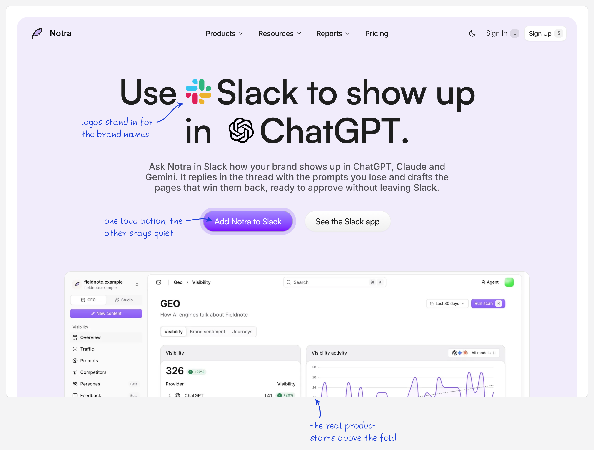
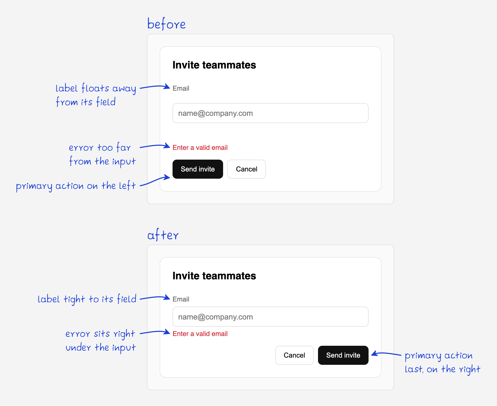
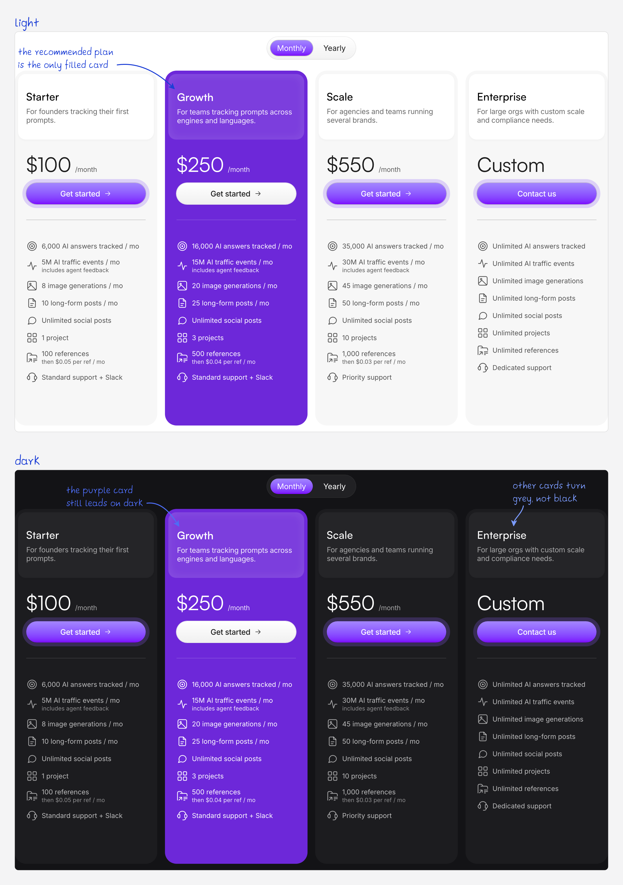
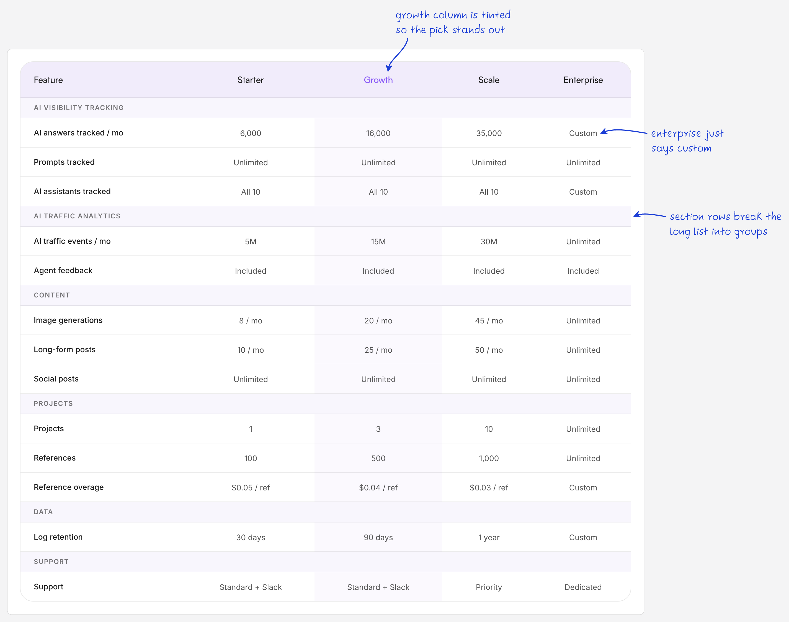

# annotate

Handwritten notes and arrows on screenshots, set in [Poah](https://poah.laks.sh/). Your coding
agent writes a small JSON spec and the CLI draws it.



## Credit

The style and the font come from [Lakshay](https://x.com/blakssh). He marks up his design work with
handwritten notes like these and drew Poah from his own handwriting. Go follow him.

## Examples

| Before and after | Light and dark |
| --- | --- |
|  |  |



The specs are in [`docs/examples`](docs/examples).

## Install

Needs [Bun](https://bun.sh). Page capture uses any installed Chromium browser.

```bash
git clone https://github.com/janburzinski/annotate ~/.agents/skills/annotate
cd ~/.agents/skills/annotate/cli && bun install
ln -s ~/.agents/skills/annotate/cli/src/index.ts ~/.local/bin/annotate
ln -s ~/.agents/skills/annotate ~/.claude/skills/annotate   # Claude Code
```

## Usage

Ask your agent to annotate a screenshot or show you a before and after. [SKILL.md](SKILL.md)
covers the rest.

By hand:

```bash
annotate spec.json        # render
annotate grid shot.png    # pixel rulers for finding coordinates
```

```json
{
  "url": "http://localhost:3000/login",
  "clip": "form",
  "notes": [{ "text": "full-width primary action", "target": "button[type=submit]" }]
}
```

Use `"image": "shot.png"` with `"to": [x, y, w, h]` boxes for existing screenshots, or `before` and
`after` keys for a comparison. Labels are placed in empty space automatically, and the CLI warns
when a note covers content.

## Development

`cd cli && bun test` runs the CLI against generated screenshots, including bad input and, when a
Chromium is installed, page capture. `bun run check` type-checks.

## License

Poah is by Lakshay, under the [SIL Open Font License](cli/fonts/OFL.txt).
