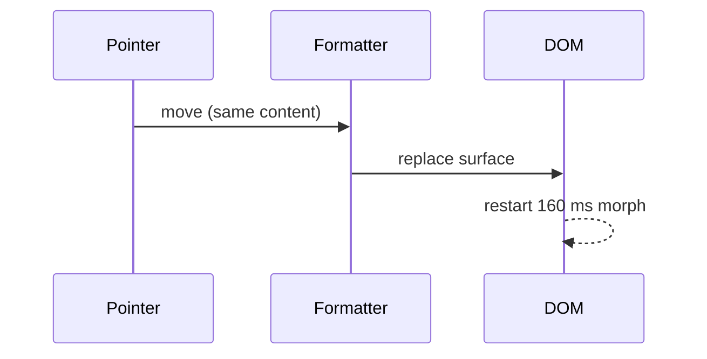

# Technical-blog PR body

Only for changes that are impressive, hard, high-risk or wide-scoped. Everything else uses
`default.md`.

Here short paragraphs are allowed. Write it like a good engineering blog post: plain words, "we"
or neutral, every claim backed by a snippet, diagram, table or image. Still no testing talk and no
branch history. If the repo has a PR template, put these sections under its description heading
as `####`.

````md
#### Problem

<Two or three sentences: what broke or was missing, what people saw, a number if there is one.>


#### Why it happened



```ts
// before: rebuilt on every pointer move
container.innerHTML = html;
```

#### What changed

- <Decision, and the alternative that lost, in one line.>
- <Decision.>

```ts
// after
if (html === lastHtml) return container;
```

#### Result

| Case | Before (`main`) | After |
| --- | --- | --- |
| … | … | … |

#### Risk and rollout

- <Blast radius: which surfaces use this.>
- <Default behavior, flag or migration.>
- <How to revert.>

#### Not in this PR

- <Only what was left out on purpose.>
````

Rules:

- Tell the story of the result, not of the attempts.
- Diagrams for flows and state, tables for comparisons, snippets for the core of the fix.
- Point at code with refs (`path/to/file.ts:42`).
