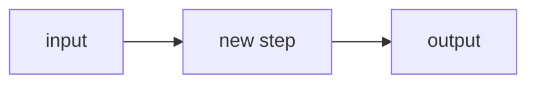
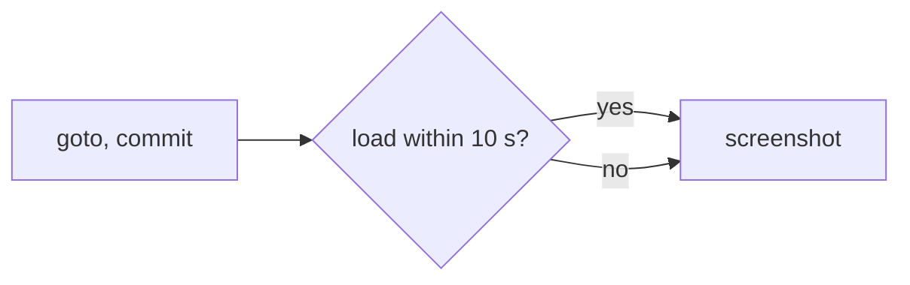

# Default PR body

Most PRs. Delete every line that does not apply.

````md
- <Verb> <what is different now, for whom>. <What was wrong before, as a short chain if it needs one>. Builds on #<n>.
- <Area>: <how it works now, with the numbers> (`<function>` in `<path/to/file.ts>`).
- <Area>: <…>
- <What stays the same, if a reviewer would ask.>
- Not in this PR: <deliberate leftovers>.
- <Env var, migration or step after merge, only if there is one.>
- Written with an AI coding agent.



```ts
// the smallest snippet that shows the idea: usage or internals
```
````

## Example

Title: `fix(cli): capture pages whose load event never fires`

````md
- Stops `annotate` from failing on pages that never finish loading. One hung font or image kept `load` from firing, so capture waited out its timeout and exited without a screenshot.
- Navigation returns on `commit`, `load` gets up to 10 s, and the screenshot is taken either way (`capture` in `cli/src/capture.ts`).
- A `wait` selector still gets its own 10 s and fails with the selector in the message.
- Pages that do load are captured exactly as before.
- Written with an AI coding agent.


````

Keep:

- 3 to 6 bullets. Every bullet says something the diff alone would not tell a reviewer quickly.
- One diagram or one snippet. Both only when each adds something.

Drop:

- Testing and validation lines.
- The history of the branch.
- A walk through the diff file by file.
